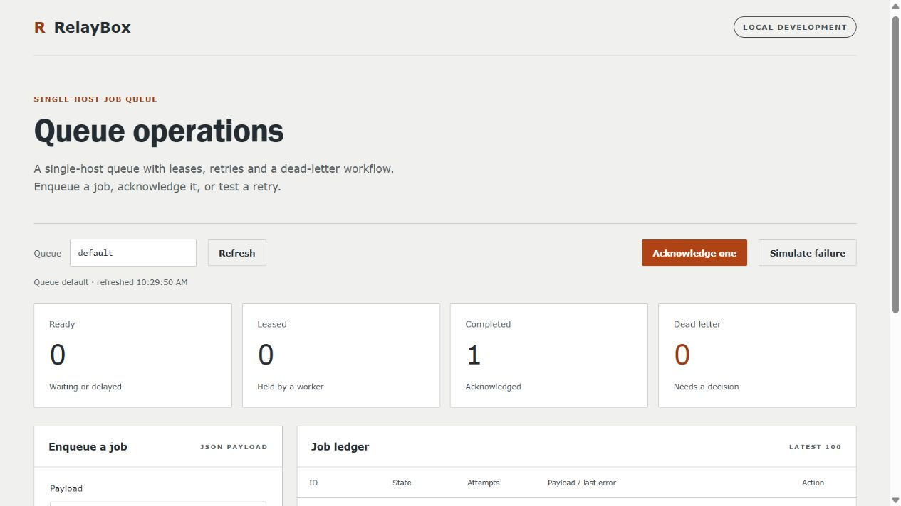
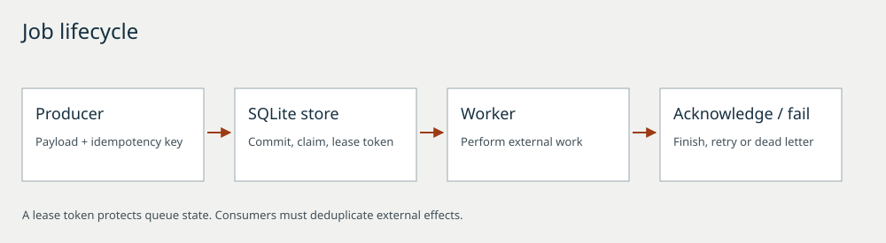
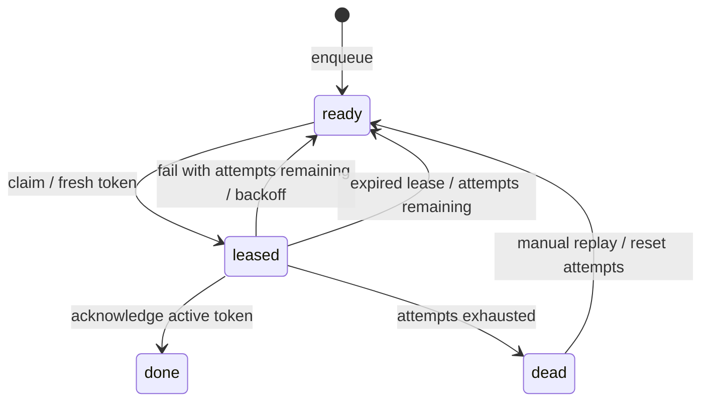

# RelayBox

A single-host job queue built to make delivery semantics, failure recovery, and operational decisions easy to inspect.

Python · SQLite · TypeScript · JavaScript

[](https://github.com/ismaeelakin/relaybox/actions/workflows/ci.yml)



## What it does

- Commits jobs to SQLite before returning success.
- Serializes claims with `BEGIN IMMEDIATE`, preventing two workers from leasing the same job at once.
- Uses a fresh capability token for every lease; expired workers cannot acknowledge a later lease.
- Retries explicit failures with capped exponential backoff and moves exhausted jobs to a dead-letter state.
- Deduplicates producer retries by queue-scoped idempotency key and canonical request fingerprint.
- Exposes a same-origin console for inspecting state, enqueueing synthetic jobs, simulating failures, and replaying dead letters.

This is a **single-host reference implementation**, not a hosted service. It uses Python's development HTTP server, binds only to loopback, and has no user authentication. Do not expose it to the internet or use sensitive payloads. The console's worker buttons demonstrate state transitions; they never execute payloads.

## Tech stack

Python 3.11+, SQLite, TypeScript and a browser console. The Python service uses the standard library.

## Run in under a minute

Requires Python 3.11+ with SQLite. No Python packages or frontend build are needed to run the checked-in console.

```sh
git clone https://github.com/ismaeelakin/relaybox.git
cd relaybox
python -m relaybox.server --db relaybox.db --port 8080
```

Open **http://127.0.0.1:8080**. Enqueue the example payload, then click **Acknowledge one**. Try **Simulate failure** three times, allowing the 2-second and 4-second retry delays between attempts. The job reaches dead letter; **Replay** resets its attempt budget.

## Architecture



## Worker protocol

```sh
curl -H "Content-Type: application/json" -d '{"queue":"default","payload":{"task":"demo"},"idempotency_key":"demo-1"}' http://127.0.0.1:8080/api/jobs
curl -H "Content-Type: application/json" -d '{"queue":"default","lease_seconds":30}' http://127.0.0.1:8080/api/claim
```

The claim returns `{"job":null}` if nothing is available. Otherwise it includes an opaque `lease_token`. Send that token to `POST /api/jobs/{id}/ack` only after the external work succeeds, or to `/fail` with a short `error` string. See [the API contract](docs/API.md).

## Delivery semantics



Delivery is **at least once**. A worker can perform an external side effect and crash before acknowledgment; another worker can later repeat the side effect. Lease fencing protects queue state, not your email provider, payment processor, or another database. Consumers need their own business-level deduplication. There is no exactly-once claim.

Expired leases are recovered during the next claim transaction. Read-only snapshots show persisted state, so an expired lease can appear leased until a worker claims again. Ready counts include delayed jobs. Idempotency keys are retained with jobs; there is no automatic deletion or compaction.

## Verify and develop

```sh
python -m unittest discover -s tests -v
npm ci
npm run check
npm run build
git diff --exit-code -- relaybox/static/app.js
```

The suite covers concurrent claims and duplicate enqueueing, restart persistence, delayed availability, queue isolation, stale-token rejection, crash recovery, retries, dead-letter replay, HTTP validation, origin/Host rejection, and static-path allowlisting. Time-sensitive store tests use an injected clock instead of sleeps. CI checks Python 3.11 and 3.13 on Linux and Windows.

## Design decisions worth reviewing

| Decision | Benefit | Cost / boundary |
| --- | --- | --- |
| SQLite WAL + short write transactions | No separate broker; durable state and exclusive claims | One writer at a time; no distributed scheduling |
| Per-operation connections | Thread-safe ownership without a shared connection | Connection overhead for every operation |
| Tokens rotate on claim | Rejects stale worker completion | No heartbeat / lease extension in v0.1 |
| Canonical JSON fingerprint | Safe producer retries with conflict detection | Request options must remain identical |
| Bounded payload and latest-100 console | Predictable individual requests | Job history itself has no retention policy |

[Architecture and failure analysis](docs/ARCHITECTURE.md) · [API](docs/API.md) · [Contributing](CONTRIBUTING.md)

## Scope

This is a single-host reference project. Retention, heartbeat extension and a hardened HTTP adapter remain future work. No production traffic or external customer use is claimed.
